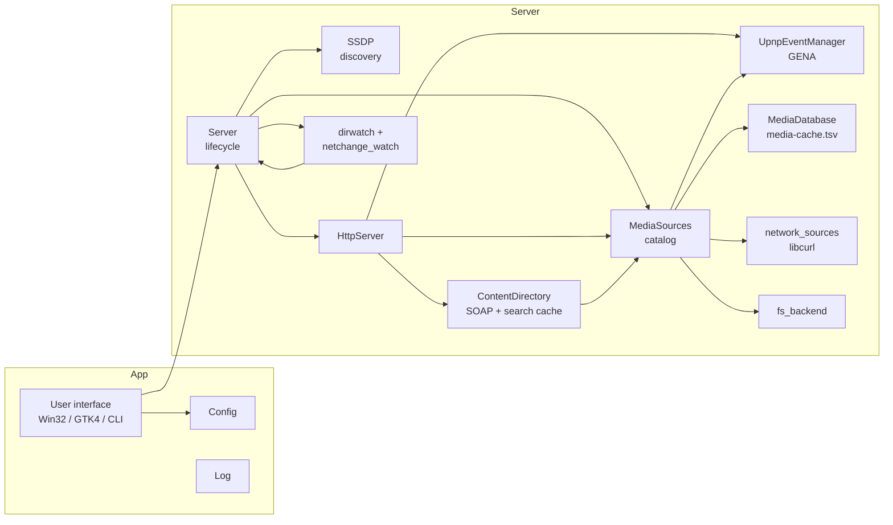
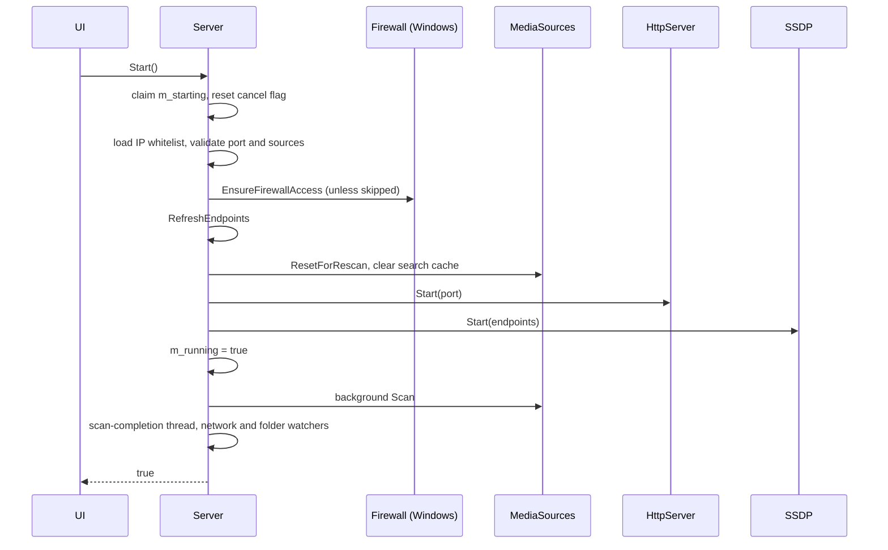

# Architecture

This page describes the components of the app, how the server starts and stops, which threads exist, which locks protect which data, and which limits bound memory. It is written for people who change the code.

## Overview

The **app** is a user interface plus the **server**. Three user interfaces exist: the Win32 window, the GTK4 window, and the POSIX command-line program. All three drive the same `Server` singleton.

## Components

| Component | Files | Job |
|---|---|---|
| `Server` | `server.cpp`, `posix_server.cpp`, `server_common.cpp` | Starts and stops everything. Owns the scan thread, the watch thread and the network watcher. Reports health. |
| `SSDP` | `ssdp.cpp`, `posix_ssdp.cpp`, `ssdp_common.cpp` | Announces the device and answers searches. See [Discovery Deep Dive](Discovery.md). |
| `HttpServer` | `httpserver.cpp`, `posix_httpserver.cpp`, `http_common.cpp` | Accepts connections. Serves description files, icons, media, subtitles, art, SOAP and event requests. |
| `ContentDirectory` | `contentdirectory.cpp` | Builds device and service XML. Implements Browse, Search and ConnectionManager. Keeps the search cache. |
| `UpnpEventManager` | `upnp_eventing.cpp` | Subscriptions and `SystemUpdateID` events. |
| `MediaSources` | `media_sources_common.cpp`, `media_scan_common.cpp` | The catalog and the scan. See [Media Library Deep Dive](Media-Library.md). |
| `MediaDatabase` | `media_database.cpp` | Stable object IDs on disk. |
| `network_sources` | `network_sources.cpp` | Playlist parsing, HLS rewrite, FTP listing, remote streaming. |
| `Config` | `config.cpp`, `posix_config.cpp` | Settings, runtime source override, thread-safe snapshots. |
| `IPWhitelist` | `ipwhitelist.cpp` | Address and CIDR check. |
| `netutils` | `netutils.cpp`, `posix_netutils.cpp`, `netutils_common.cpp` | Adapter and address enumeration, best-endpoint choice, text helpers. |
| Watchers | `dirwatch_win.cpp`, `dirwatch_posix.cpp`, `netchange_watch_*.cpp`, `source_watcher.cpp` | Folder and network change detection. |
| Firewall | `firewall_access_win.cpp` | Windows Firewall rules. |
| Single instance | `main.cpp` (mutex, window messages), `posix_single_instance.cpp` | One instance per user, and messages between instances. |
| User interfaces | `mainwindow.cpp`, `settingsdlg.cpp`, `logdlg.cpp`, `help_dialog.cpp` (Win32); `gtk4_gui_main.cpp`, `posix_tray.cpp` (GTK4); `posix_main.cpp` (CLI) | Present state. Call `Server`. |

## Server lifecycle

### Start

`Server::Start(reason)` returns `true` when the server is advertised. It does not wait for the scan.

Failure paths return `false` with a reason and clear `m_initialScanInProgress`. The catalog root and `m_initialScanComplete` are set before HTTP starts, so a Browse that arrives right after the port opens finds a root container instead of error 710.

`m_rescanMutex` is held while the catalog resets. `Server::Rescan()` takes the same mutex. This stops a rescan from publishing items while `Start()` clears the catalog.

### Stop

Order in `Server::Stop()`:

1. Set `m_running` to false and `m_stopping` to true. Raise the scan cancel flag.
2. Join the scan-completion thread.
3. Stop watch mode, the network watcher and the directory watcher.
4. `SSDP::Stop()`: send due responses, send `byebye`, close sockets.
5. `HttpServer::Stop()`: close listeners, end subscriptions, drain workers.
6. Join the scan thread.
7. Clear the runtime source override and the endpoint list.

### Health

`Server::IsHealthy()` is true when the server is stopped. When it runs, it is true only if the HTTP accept loop and the SSDP worker are alive. The user interfaces poll it. `ShouldTreatServerAsUnhealthy` needs four polls in a row to fail before it acts. One failed poll can be a normal SSDP restart.

## Threads

| Thread | Created by | Ends when |
|---|---|---|
| Interface thread | OS | App exit. Runs the window, owns direct reads of `Config::mediaSources`. |
| Start, stop and rescan workers | Interface | The operation ends. One at a time (`m_worker`, `m_rescanWorker`). |
| Scan thread | `Server::StartBackgroundScan` | Scan ends or is cancelled. |
| Scan-completion thread | `Server::Start` | Initial scan ends, then starts watch mode. |
| Source scan workers | `SourceScanPool` | Pool destruction. One job per source. Count: `min(2 × cores, 64)`. Four cores if the count is unknown. |
| Playlist scan workers | `PlaylistScanPool` | 20 workers, queue depth 200. Run leaf playlist nodes. |
| HTTP accept loop | `HttpServer::Start` | Stop. Windows: one thread over both families. Linux: one thread per family. |
| HTTP client workers | Windows thread pool (4 to 64) or `BoundedThreadPool` (64, queue 64) | Connection ends. |
| SSDP worker | `SSDP::Start` | Stop. Receives searches, sends periodic alive messages. |
| SSDP response worker | `SSDP::Start` | Stop. Sends delayed search responses. |
| SSDP initial burst | `SSDP::Start` | Burst list ends or Stop. Joined in `Stop` before sockets close. |
| GENA worker | First subscription | Process exit. Debounces and queues notifications. |
| GENA notify pool | GENA worker | Eight workers. Send `NOTIFY` with libcurl. |
| Watch loop | `StartWatchMode` | Stop. Polls the folder signature. |
| Folder watch | `StartDirectoryWatch` | Stop. |
| Network watch, deferred fire | `StartNetworkChangeWatch` | Stop. |

### The two scan pools

A source job blocks while it waits for its playlist tasks. If source jobs shared the playlist pool, enough waiting jobs would leave no worker to run the tasks they wait for. That is a permanent deadlock. So `SourceScanPool` runs top-level jobs and `PlaylistScanPool` runs leaf nodes. Source jobs never run on the playlist pool. The comment in `MediaSources::Scan()` says not to change this.

### Re-entry guards

| Where | Guard |
|---|---|
| `HttpServer::Start/Stop`, `SSDP::Start/Stop` | An atomic `m_lifecycleBusy` flag set with compare-and-swap. A second caller fails fast and logs. |
| `Server::Start` | `m_starting`. Released by a guard object on every return path. |
| `Server::RestartSsdpForNetworkChange` | `m_ssdpRestartMutex`, plus a skip when the last restart was under two seconds ago. |
| Interface | `IsBusy()` blocks new start, stop and scan requests. |

### Exceptions

An exception that leaves a `std::thread` function ends the process. The code wraps entry points with `RunGuarded`. `BoundedThreadPool::WorkerLoop` and the Windows `WorkerCallback` catch exceptions around each task, so one bad request does not stop other clients.

## Locks and shared data

| Data | Lock | Rule |
|---|---|---|
| Settings | `Config::m_mutex` (shared mutex) | Do not call `LogPrint` while held. Write with `Mutate()`. Read with `Snapshot()` or a getter. `Save()` copies the data, releases the lock, then writes the file. |
| Catalog (`m_items`, `m_idToIndex`, `m_childrenByParent`) | `MediaSources::m_mutex` (shared mutex) | HTTP threads read. Scan threads write. Publish functions release the lock before they raise `SystemUpdateID` events. |
| Per-source scan caches | `MediaIndexState::mutationMutex` | Held only for map access. Disk listing and file checks run without it. |
| Object IDs | `MediaDatabase::m_mutex` | `Save()` builds the text under the lock, releases it, then writes and renames. |
| Search cache | `ContentDirectory::m_searchCacheMutex` | Search work happens outside the lock. |
| Subscriptions and queue | `UpnpEventManager::m_mutex` | `m_subscriberCount` is atomic so a scan with no subscribers never takes the lock. |
| SSDP sends | One mutex per address family | A send on one family does not wait for the other. |
| SSDP response queue | `m_responseMutex` | |
| Log ring | `g_logMutex` | File and console writes happen after the lock is released. |
| Remote probe cache | `g_probeCacheMutex` | |
| Routable host cache | `g_routableHostCacheMutex` | |

### Scan batching

During a scan, `m_publishBatchDepth` is above zero. Publish functions still raise `SystemUpdateID` for each item, but they skip event dispatch. One event is sent when the scan ends. Without it, each of thousands of items would walk the subscriber table.

### Cancellation

`ScanCancellation` holds one atomic flag. `Server::Stop` and the Linux window's close path raise it. Scan loops check it. libcurl transfers check it in a progress callback and abort. A cancelled scan does not sweep the catalog and does not write `media-cache.tsv`.

## Resource limits

Every cache, queue and buffer has a bound. Memory use is bounded by these values, not by library size.

| Limit | Value | Where |
|---|---|---|
| HTTP client workers | 64 | `kMaxClientThreads`, `http_common.h` |
| HTTP request header | 64 KiB | `ReadHttpRequestHeaders` |
| SOAP body | 1 MiB | `kMaxSoapBodyBytes` |
| Items per Browse or Search reply | 16,000 | `kMaxBrowseResponseItems` |
| Search cache | 256 containers and 200,000 items | `contentdirectory.h` |
| UPnP subscriptions | 64. The one closest to expiry is replaced. | `kMaxUpnpSubscriptions` |
| Queued notify jobs | 256, one per subscription (newer replaces older) | `upnp_eventing.cpp` |
| Notify workers | 8 | `kMaxUpnpNotifyWorkers` |
| Queued SSDP search replies | 256. Oldest is dropped. | `kMaxDelayedResponses` |
| Log ring | 1,000 lines | `log.cpp`, `posix_log.cpp` |
| Remote size cache | 2,000 URLs, 5-minute lifetime, 64 removed per overflow | `network_sources.cpp` |
| Concurrent remote size probes | 4 | `g_remoteProbeLimiter` |
| Fetched playlist text | 4 MiB | `kMaxCurlOutputBytes` |
| `.pls` index | 10,000 | `kMaxPlsIndex` |
| Playlist nesting | 8 | `kMaxPlaylistRecursionDepth` |
| Local folder depth | 64 | `kMaxLocalFolderDepth` |
| Network folder depth | 8 | `kMaxNetworkFolderDepth` |
| Folder watch depth | 64 | `dirwatch_posix.cpp`, `source_watcher.cpp` |
| Playlist workers and queue | 20 and 200 | `playlist_scan_concurrency.h` |
| Icon cache | 3 files | Fixed by the three icon routes |

The catalog itself grows with the number of items. `ResetForRescan` reserves 4,096 entries. `SweepStaleEntries` rebuilds the vectors after a scan so removed items free their memory. The ID free list reuses IDs of removed items, so the ID counter does not grow on a library that changes often.

## Configuration flow

`AppConfig` is the singleton. `Server::Start` takes one `ConfigSnapshot` and passes parts of it to its components. A snapshot has `effectiveMediaSources`: the command-line sources when they exist, otherwise `mediaSources`. Code that scans or watches must use `effectiveMediaSources`, never `mediaSources`.

## User interface layer

Each user interface keeps its own widget code but uses the same state classes and decision functions. Examples: `ClosePendingState`, `SourceListFocusState`, `HoverFocusState`, `KeyboardCueState`, `ModalStack`, `DecideFunctionKeyAction`, `ShouldCloseNow`. When a behavior must match on both platforms, add a pure function and call it from both. See [Development Guide](Development-Guide.md#pure-decision-headers).

Server operations run on a worker thread. The worker reports back to the interface thread: a posted window message on Windows, a pending-result slot polled every 250 ms on GTK.
