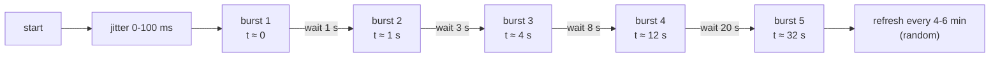
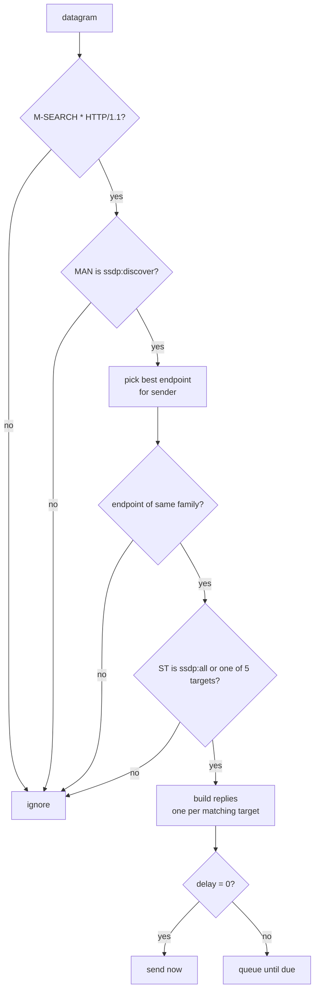
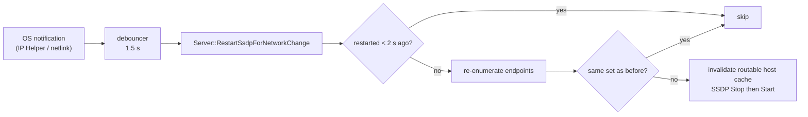

# Discovery Deep Dive

This page explains how the server makes itself visible: which addresses it advertises, which messages it sends and when, how it answers searches, and how it reacts to network changes. It assumes you know UPnP Device Architecture (UDA) 1.0/1.1 and SSDP.

Files: `ssdp.cpp` (Windows), `posix_ssdp.cpp` (POSIX), `ssdp_common.cpp` (shared messages and timing), `netutils*.cpp` (adapters), `netchange_watch_*.cpp`, `server_common.cpp` (restart logic), `firewall_access_win.cpp`.

## What makes detection fast

A control point finds a device in one of three ways: it hears an `ssdp:alive`, it receives an answer to its own `M-SEARCH`, or it reads a cached advertisement. The server supports all three:

1. A burst of announcements right after start, with short gaps (below).
2. A reply to every matching `M-SEARCH`, with a delay inside the limit the standard sets.
3. A new burst after the address set changes.
4. A periodic refresh every 4 to 6 minutes, well inside the 1,800 s `max-age`.

Detection also needs a reachable address and an open firewall. Most "not found" reports come from those two, not from SSDP timing. See [Troubleshooting](Troubleshooting.md).

## Which addresses are advertised

`EnumerateNetworkEndpoints(port, allowList, out)` returns a `NetworkEndpoint` list. Each entry has an address family, interface index, prefix length, whether it is link-local, and the `LOCATION` URL `http://<host>:<port>/description.xml`. IPv6 hosts are in brackets and never carry a zone ID, because a zone ID has meaning only on the machine that made it.

### Adapter filter

An adapter is skipped when it is loopback, down, or has no multicast flag. Then the allow list decides:

| `NetworkInterfaceAllowList` | Rule |
|---|---|
| Empty | `ShouldUseUnlistedInterface(isLikelyVirtualByName, hasDefaultGateway)`: use the adapter if its name does not look virtual, or if it has a default gateway. |
| Not empty | Use only adapters whose name contains one of the items. No virtual-name rule. |

The default rule never excludes by name alone. A bridged virtual switch, or a VM adapter on the real LAN, has a gateway and passes. A host-only NAT adapter has none and is excluded.

How "has a default gateway" is found differs by platform. See [Platform Differences](Platform-Differences.md#adapter-selection). On Linux the answer is true only for the interface that owns the source address the kernel selects for `8.8.8.8` (IPv4) or `2001:4860:4860::8888` (IPv6). Offline hosts get no default route, so no interface counts as having a gateway, and only non-virtual names pass.

### One address per adapter and family

Control points key a device by USN and keep the last `LOCATION` they saw. If one adapter advertised two addresses, a reachable `LOCATION` could be replaced by an unreachable one. So the server keeps one address for each (adapter, family):

- **Windows:** the first non-APIPA (not 169.254.x.x) IPv4 address. For IPv6, the highest rank: global (2) beats link-local (1). Unusable (unspecified, loopback, multicast) is 0.
- **Linux:** the first address that `getifaddrs` returns for that interface and family. APIPA IPv4 addresses are skipped. IPv6 addresses are not ranked.

### Link-local IPv6 drop

After collection, if any non-link-local endpoint exists, all link-local endpoints are removed (`ShouldDropLinkLocalEndpoint`). A bare `fe80::` address is useless to clients that have more than one interface, for example a phone on Wi-Fi and cellular. If link-local addresses are all the machine has, they stay.

A side effect: an adapter with only a link-local IPv6 address stops joining the IPv6 group. Clients reach the server over IPv4.

## Sockets

| Property | Value |
|---|---|
| Ports | UDP 1900, one IPv4 socket and one IPv6 socket, bound to the any-address |
| Groups | `239.255.255.250` and `ff02::c` |
| Options | `SO_REUSEADDR` (and `SO_REUSEPORT` on Linux); multicast TTL and hops 4; IPv6 only on the IPv6 socket |
| Membership | One join per endpoint, on that endpoint's interface |
| Windows start rule | Fails if both sockets fail, or if no join worked on any endpoint |
| Linux start rule | Fails only if both sockets fail. A failed join is not counted. |

Reuse options let other SSDP programs on the host (for example another media server) share port 1900.

## Targets

`BuildAdvertisedTargets(uuid)` returns five targets, each with an `NT`/`ST` and a `USN`.

| NT / ST | USN |
|---|---|
| `upnp:rootdevice` | `uuid:<uuid>::upnp:rootdevice` |
| `uuid:<uuid>` | `uuid:<uuid>` |
| `urn:schemas-upnp-org:device:MediaServer:1` | `uuid:<uuid>::urn:schemas-upnp-org:device:MediaServer:1` |
| `urn:schemas-upnp-org:service:ContentDirectory:1` | `uuid:<uuid>::urn:schemas-upnp-org:service:ContentDirectory:1` |
| `urn:schemas-upnp-org:service:ConnectionManager:1` | `uuid:<uuid>::urn:schemas-upnp-org:service:ConnectionManager:1` |

## Announcements

### Timeline

- A burst is two rounds, 150 ms apart. A round sends five `NOTIFY ssdp:alive` messages (one per target) on every endpoint.
- The waits are between bursts, so the times above add up. The wait uses a condition variable and ends at once when the server stops.
- The periodic interval is drawn uniformly from 4 to 6 minutes. UDA requires a refresh in less than half of `max-age` (900 s). Jitter keeps several instances from refreshing together. A shorter interval than the usual 12 to 14 minutes gives clients with short discovery windows more chances to hear it.
- On stop: one round of `NOTIFY ssdp:byebye`.
- The initial burst runs on its own thread. It is joined in `Stop()` before the sockets close, so it can never touch a closed socket.

### NOTIFY fields

`ssdp:alive`: `HOST`, `CACHE-CONTROL: max-age=1800`, `LOCATION`, `NT`, `NTS`, `SERVER`, `USN`, `BOOTID.UPNP.ORG`, `CONFIGID.UPNP.ORG`, `OPT: "http://schemas.upnp.org/upnp/1/0/"; ns=01`, `01-NLS`.

`ssdp:byebye`: the same without `CACHE-CONTROL`, `LOCATION` and `SERVER`.

Before each send, the multicast output interface is set to the endpoint's interface (`IP_MULTICAST_IF` / `IPV6_MULTICAST_IF`). A mutex per address family serializes sends and the socket close.

### BOOTID and CONFIGID

- `BOOTID.UPNP.ORG` is the Unix time at the first start in this process. It stays the same across later starts in the same process. UDA says it must change only when the device really reboots. An SSDP restart after a network change is not a reboot.
- `CONFIGID.UPNP.ORG` is always 1. The device and service descriptions never change while the app runs.

## Answering M-SEARCH

### Endpoint choice

`SelectBestEndpoint(endpoints, remote)` only considers endpoints of the sender's family and scores them:

| Condition | Score |
|---|---|
| Sender is inside the endpoint's subnet (prefix match) | +100 |
| IPv6 link-local endpoint on the interface named by the sender's scope ID | +50 |
| Not link-local | +10 |

The highest score wins. The scope ID check is needed because every `fe80::/10` address matches the same prefix on every interface (RFC 4291, RFC 4007). If nothing matches, the first endpoint of the same family is used. The reply carries that endpoint's `LOCATION`, so the player gets an address on its own subnet.

### Delay

`ComputeDelayMilliseconds(mx)`:

- `MX` is read as an integer. A missing or bad value is 1.
- The value is clamped to 0 to 5. A value of 1 or less gives delay 0.
- Otherwise the upper bound is `min(0.8 × MX × 1000, 1000)` ms. Every `MX` from 2 to 5 therefore gives 1,000 ms.
- The delay is uniform in `[0, bound]`.

UDA asks for a random delay below `MX`. The 0.8 factor and the 1 s cap keep a late reply from missing a client that closes its window early.

### Sending the reply

- Each message is sent **twice** in a row (`kSearchResponseSendCount`). UDP loses packets, and one lost reply means a missed device.
- The reply is unicast to the sender. The outbound interface is pinned with `IP_UNICAST_IF` / `IPV6_UNICAST_IF` (Windows) so the reply leaves on the interface the search arrived on. On Linux the interface index is passed in network byte order, as the kernel requires. The pin is a hint. If it fails, the normal route is used.
- Reply fields: `CACHE-CONTROL`, `DATE`, `EXT:`, `LOCATION`, `SERVER`, `ST`, `USN`, `BOOTID.UPNP.ORG`, `CONFIGID.UPNP.ORG`, `Content-Length: 0`.

### The delayed queue

Replies that wait for their time sit in a `std::deque`. The response thread sleeps until the earliest due time.

- A new reply for the same sender, with the same list of `ST` and `USN`, replaces the queued one (`CoalesceDelayedResponse`). A repeated search does not double the work.
- The queue holds 256 entries. At the limit the oldest is dropped. `pop_front` on a deque is O(1); an erase at the front of a vector would shift every element on each search of a flood.
- On `Stop()`, replies due within 250 ms are sent first, then the rest are dropped.

## Network changes

- **Sources.** Windows: `NotifyIpInterfaceChange` and `NotifyUnicastIpAddressChange`. Linux: a netlink socket for link, IPv4 address and IPv6 address groups. Other systems: not available.
- **Debounce.** `NetworkChangeDebouncer` acts on the first event at once and remembers later events inside the 1.5 s window. A deferred thread then fires once at the window's end, so the last change in a burst is never lost.
- **No-op detection.** `NetworkEndpointSetsEqual` compares the sets of (family, address, interface index), in any order. If the set is unchanged, the server keeps its sockets. This avoids a stop/start storm when an adapter reports many events.
- **Restart.** Stop sends `byebye` for the old addresses. Start joins groups on the new interfaces and runs the announcement timeline again. `BOOTID` stays the same.
- **Resume from sleep.** The Windows window calls the same function on resume. The two-second rule and the endpoint comparison apply, so a resume that changes no address does not restart SSDP.
- **Serialization.** The network thread and the resume handler share `m_ssdpRestartMutex`.

## Windows Firewall

A discovery socket receives nothing if the firewall drops the datagrams. On Windows the app manages two inbound rules for its own executable path:

| Rule name | Protocol | Local port | Remote | Profiles |
|---|---|---|---|---|
| `DLNA Server-<n> HTTP TCP` | TCP | any | `LocalSubnet` | Domain, Private, Public |
| `DLNA Server-<n> SSDP UDP` | UDP | 1900 | `LocalSubnet` | Domain, Private, Public |

`<n>` is the first five digits of a 64-bit FNV-1a hash of the executable path, written in decimal. Moving the exe gives new rule names.

Flow in `EnsureFirewallAccess`:

1. A cached "configured" answer for this exe path returns at once.
2. Otherwise read all rules through `INetFwPolicy2`. If a complete allow rule exists for TCP and UDP and both current names exist, cache and return.
3. Non-interactive mode returns a message that tells the user to run `--configure-firewall`.
4. Interactive mode asks Yes/No. On Yes, an elevated copy of the exe runs `--configure-firewall --port N` through `ShellExecute` with `runas`.
5. The elevated run stops early if both current rules already exist. Otherwise it removes old rules (current names, group `DLNA Server`, matching block rules, old port-specific TCP rules, and any rule whose name starts with `DLNA Server-`), adds the pair, and checks that they exist.

A standard user may not be allowed to read the rule set. An `ACCESS_DENIED` result on the read is handled by going on to the elevation step. After elevation, an `ACCESS_DENIED` on the recheck is treated as success.

Setting `DLNA_SERVER_SKIP_FIREWALL` skips all of this.

## Known limits

- Only five targets exist. A search for any other `ST` gets no answer.
- No `ssdp:update` message is sent. A changed address set causes `byebye` and a new `alive` burst.
- The IP whitelist does not apply to SSDP. It applies to HTTP.
- Link-local IPv6 is dropped whenever another address exists.
- One address per adapter and family.
- Linux does not fail the start when every multicast join fails. Check the log for `SSDP IPv4 multicast join ok`.
- Network and folder watchers exist only on Linux and Windows.
